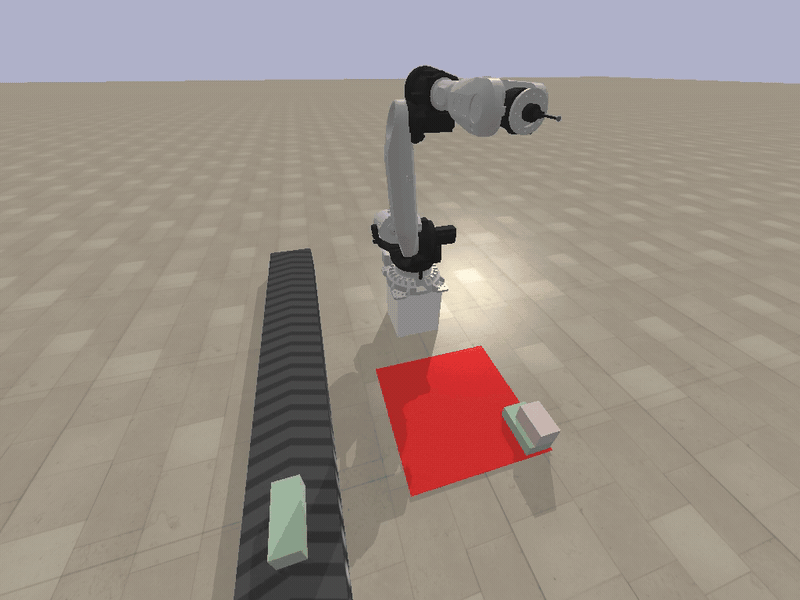
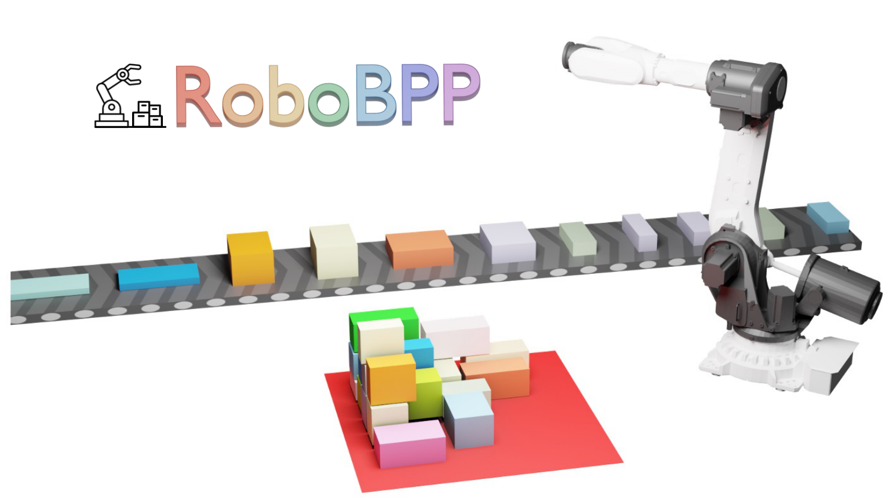

<div align="center">

# RoboBPP

### Benchmarking Robotic Online Bin Packing with Physics-based Simulation

**Accepted to The International Journal of Robotics Research (IJRR), 2026**

Zhoufeng Wang · Hang Zhao · Juzhan Xu · Shishun Zhang · Ruizhen Hu · Chenyang Zhu<br>
Zecui Zeng · Weiyan Zhu · Zeyu Xiong · Haibin Yu · Kai Xu

[](https://robot-bin-packing-benchmark.github.io/)
[](https://arxiv.org/abs/2512.04415)
[](https://robot-bin-packing-benchmark.github.io/download.html)
[](https://robot-bin-packing-benchmark.github.io/benchmark.html)
[](#getting-started)

A unified benchmark for robotic online bin packing with real industrial datasets,<br>
physics-based simulation, and robot-aware evaluation.

<a href="https://robot-bin-packing-benchmark.github.io/">
  
</a>

*Execution Pack on the Repetitive dataset. Simulation footage, shown at 3× speed.*<br>
[Watch all demos](https://robot-bin-packing-benchmark.github.io/) · [Read the paper](https://arxiv.org/abs/2512.04415) · [Cite RoboBPP](#citation)

</div>

## News

- **2026-11-09** — RoboBPP has been accepted to **IJRR**! Thank you to all collaborators and reviewers.

## Overview

Packing efficiently is only part of the challenge: a robot must also execute the placements safely, and the resulting stack must remain stable. **RoboBPP** brings these requirements into a unified evaluation framework for **robotic online 3D bin packing**.

- **Real industrial data.** Three datasets capture repetitive supply streams, diverse parcel sizes, and long, slender wood boards.
- **Three levels of evaluation.** Math Pack, Physics Pack, and Execution Pack progressively introduce physical dynamics and robotic execution.
- **Robot-aware metrics.** Evaluate packing performance alongside structural stability and operational safety.
- **Reproducible comparisons.** Baseline implementations, evaluation code, visualization tools, and an online leaderboard support benchmarking and further research.

<p align="center">
  
</p>

## Benchmark Settings

| | Math Pack | Physics Pack | Execution Pack |
| :--- | :--- | :--- | :--- |
| **Focus** | Geometric packing | Physical feasibility | Robotic execution |
| **Physics** | Disabled | Gravity, friction, and collisions | Gravity, friction, and collisions |
| **Robot** | No | No | Motion planning and control |
| **Key question** | Does the placement fit? | Does the stack remain stable? | Can the robot execute the placement? |
| **Setting ID** | `1` | `2` | `3` |

See the [benchmark results](https://robot-bin-packing-benchmark.github.io/benchmark.html) for comparisons across settings, and the [documentation](https://robot-bin-packing-benchmark.github.io/documentation.html) for metric definitions.

## Datasets

All three datasets are collected from real industrial workflows.

| Dataset | Scenario | Main characteristic | Code identifier |
| :--- | :--- | :--- | :--- |
| **Repetitive** | Manufacturing and supply workflows | Consecutive items with repeated dimensions | `time_series` |
| **Diverse** | Office supplies and logistics packing | Heterogeneous item sizes | `occupancy` |
| **Wood Board** | Furniture manufacturing | Long, slender items | `flat_long` |

**[Request / download datasets](https://robot-bin-packing-benchmark.github.io/download.html)** · [Dataset descriptions and statistics](https://robot-bin-packing-benchmark.github.io/documentation.html)

## Getting Started

### 1. Get the code and data

```bash
git clone https://github.com/zhoufeng9/RoboBPP.git
cd RoboBPP
```

Obtain the industrial datasets through the [download page](https://robot-bin-packing-benchmark.github.io/download.html). Update dataset and checkpoint paths in the configuration of the method you intend to run.

### 2. Choose your workflow

| I want to… | Start here |
| :--- | :--- |
| Explore the benchmark and watch simulations | [Project website](https://robot-bin-packing-benchmark.github.io/) |
| Use the standalone simulation API | [`packsim` documentation and sample files](https://robot-bin-packing-benchmark.github.io/documentation.html#environment) |
| Train a learning-based baseline | [`code/learning_based/`](code/learning_based/) |
| Run heuristic baselines | [`code/heuristics/`](code/heuristics/) |
| Evaluate algorithms in the benchmark | [`test/`](test/) and its method-specific entry points below |
| Inspect metric-validation experiments | [`experiment/`](experiment/) |
| Submit a method for evaluation | [Submission guide](https://robot-bin-packing-benchmark.github.io/submit.html) |

**Simulation API.** The simulator is distributed as `packsim`:

```bash
python -m pip install packsim
```

The [simulation guide](https://robot-bin-packing-benchmark.github.io/documentation.html#environment) explains the `from packsim import simulate` API and links sample configuration, action, and planning-time files. Configure the data paths in `default.yaml` before running the example. The simulator also requires its Python and native simulation dependencies; installing the package alone is not a complete environment setup.

**Baseline reproduction.** Dependencies and launch options vary by method. Start with the relevant method's README or requirements file, then adapt its evaluation script to your local dataset and checkpoint paths.

| Method / family | Training code | Evaluation entry point |
| :--- | :--- | :--- |
| AR2L | [`AR2L`](code/learning_based/AR2L/) | [`Benchmark-ar2l/demo.sh`](test/Benchmark-ar2l/demo.sh) |
| PCT | [`PCT`](code/learning_based/PCT/) · [`PCT-full`](code/learning_based/PCT-full/) | [`Benchmark-pct/demo.sh`](test/Benchmark-pct/demo.sh) |
| TAPNet++ | [`TAPNet++`](code/learning_based/TAPNet++/) | [`Benchmark-tap/demo.sh`](test/Benchmark-tap/demo.sh) |
| PackE / CDRL | — | [`Benchmark-packe-cdrl`](test/Benchmark-packe-cdrl/) |

The evaluation scripts specify the setting, dataset, method, and test configuration IDs. Pretrained models included in this repository are available under [`test/model/`](test/model/).

## Repository Structure

```text
RoboBPP/
├── assets/                 # README demo and benchmark overview
├── code/
│   ├── heuristics/         # Heuristic packing implementations
│   └── learning_based/     # Learning-based implementations and training
├── test/
│   ├── Benchmark-ar2l/     # AR2L evaluation
│   ├── Benchmark-packe-cdrl/
│   ├── Benchmark-pct/      # PCT evaluation
│   ├── Benchmark-tap/      # TAPNet++ evaluation
│   ├── data/              # Bundled data files
│   └── model/             # Pretrained checkpoints
└── experiment/             # Experiments validating benchmark metrics
```

## Citation

If RoboBPP supports your research, please cite our paper. The paper has been accepted to **IJRR**; the BibTeX below refers to the available arXiv version and will be updated when the journal citation is available.

```bibtex
@article{wang2025robobpp,
  title   = {{RoboBPP}: Benchmarking Robotic Online Bin Packing with Physics-based Simulation},
  author  = {Wang, Zhoufeng and Zhao, Hang and Xu, Juzhan and Zhang, Shishun and
             Hu, Ruizhen and Zhu, Chenyang and Zeng, Zecui and Zhu, Weiyan and
             Xiong, Zeyu and Yu, Haibin and Xu, Kai},
  journal = {arXiv preprint arXiv:2512.04415},
  year    = {2025},
  doi     = {10.48550/arXiv.2512.04415},
  url     = {https://arxiv.org/abs/2512.04415}
}
```

## Acknowledgements

We thank all collaborators who contributed to RoboBPP and the authors of the packing methods and open-source tools used in this benchmark. Please also cite the original methods when using their implementations. See the [project website](https://robot-bin-packing-benchmark.github.io/) for the collaborating institutions.

For questions, bug reports, or suggestions, please [open an issue](https://github.com/zhoufeng9/RoboBPP/issues).
